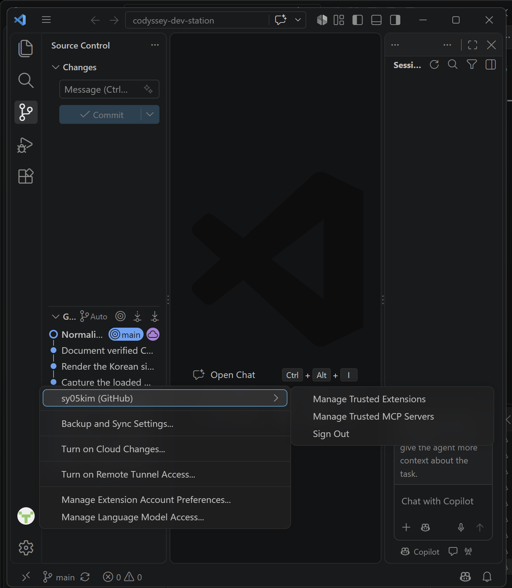

# Git 설정 및 GitHub·VS Code 연동

## GitHub 원격 연결 기록

공개 저장소를 복제한 Linux 작업 환경에서 실행한 결과입니다. 검증용 복제본에 `init.defaultBranch=main`을 설정했습니다. 설정 목록은 필요한 항목만 남기고 사용자 값은 가렸습니다.

```text
$ git config --local init.defaultBranch main
$ git config --list
user.name=[가림]
user.email=[가림]
init.defaultbranch=main
$ git branch --show-current
main
$ git remote -v
origin	https://github.com/sy05kim/codyssey-dev-station.git (fetch)
origin	https://github.com/sy05kim/codyssey-dev-station.git (push)
$ git status --short --branch --untracked-files=no | head -1
## main...origin/main
```

[GitHub main의 커밋 이력](https://github.com/sy05kim/codyssey-dev-station/commits/main/)에서 원격 반영을 확인할 수 있습니다.

## Windows Git 사용자 설정 증거

기존 실습 기록에는 사용자 이름과 이메일을 설정했다고 적혀 있습니다. 개인 PC에서 `git config --list` 결과를 공유할 때는 VS Code PowerShell 터미널에서 아래처럼 필요한 항목만 표시합니다. 이름이나 이메일이 나오지 않으면 해당 설정을 먼저 확인합니다.

```powershell
git config --list |
  Where-Object { $_ -match '^(user\.(name|email)|init\.defaultbranch)=' } |
  ForEach-Object { $_ -replace '^(user\.(?:name|email))=.+$', '$1=[가림]' }
git branch --show-current
```

## VS Code 연동 캡처

Windows의 VS Code에서 `codyssey-dev-station` 저장소를 열고 Source Control에 표시된 `main` 브랜치를 확인했습니다. Accounts 메뉴의 `sy05kim (GitHub)` 표시는 GitHub 로그인 상태를 보여 줍니다.


